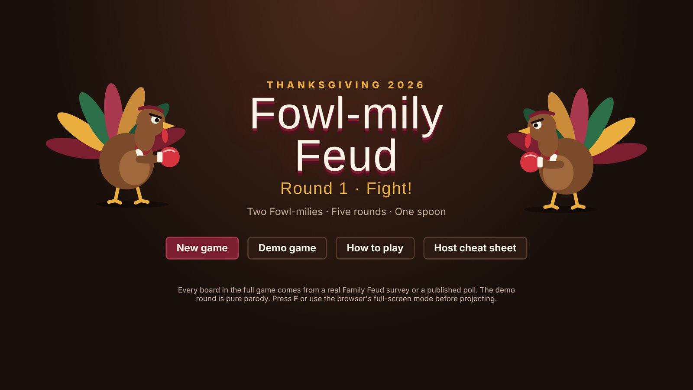
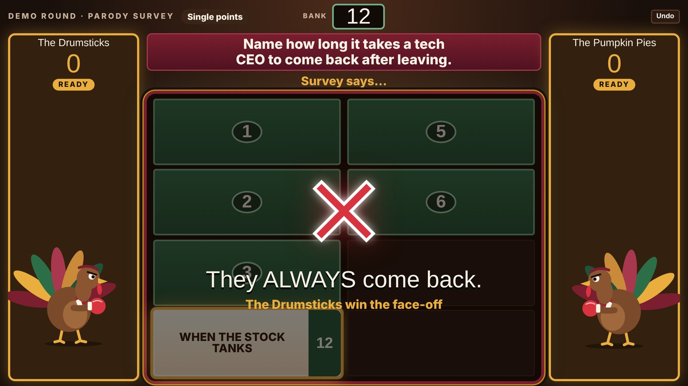

# 🦃 Fowl-mily Feud

A Family Feud–style party game for Thanksgiving, made to run on a laptop hooked up to a TV. Two teams ("Fowl-milies"), one host, a spoon for a buzzer, and two boxing turkeys who take it very personally.

**▶ Play it:** https://gabzhou.github.io/fowl-mily-feud/



## What's in it

- **5 rounds** (single, single, double, double, triple points), plus a one-round **Demo game** that's a parody board, for trying it out.
- **The host types what players say** and the game checks it, forgiving typos and different phrasings. Answers get a drumroll, then a tile flip or a big red ✕.
- **Real Family Feud rules:** face-off, play or pass, three strikes, steal. The game works out who wins control on its own.
- **Turkeys show what's happening:** jabbing while they play, snoozing while they wait, a robber mask for the steal, a champ belt or a knockout at the end of the round.
- Sound effects, confetti, an Undo button, and a **host cheat sheet** with every answer and its source. Open it on your phone, not the TV.
- One HTML file. Nothing to install, no build step.



## Run it

**Online:** open the link above.

**Offline:** download `index.html` and double-click it. You need an internet connection for the fonts; everything else works offline.

Then press **F** for full screen, plug into the TV, and you're the host.

## Host tips

1. Split into two teams. House rule: couples play on opposite teams.
2. Put a spoon in the middle of the table. It stays down until the question is finished.
3. For the face-off, click **Got the spoon!** under the team that grabbed it first, then type their answer.
4. The game handles control, strikes and steals. If you disagree with it, click a tile to reveal it, use **Give control to this team**, or press **Undo**.
5. Keyboard: `1`–`8` reveal a tile, `X` adds a strike, `F` toggles full screen.

## Make your own boards

All the questions are at the top of the `<script>` in `index.html`, in `REAL_ROUNDS`. Each round looks like this:

```js
{ q:"Name something people secretly do during a video call.", mult:1,
  src:"Where the answers came from",
  a:[
    ["Eat", 45, ["eating","snack","lunch"]],            // [board text, points, other accepted answers]
    ["Hide clutter in a closet", 40, ["clean up","tidy"]],
    // up to 8 answers, highest points first
  ]},
```

- `mult` is 1, 2 or 3 (single, double or triple points).
- The third item in each answer lists other ways people might say it. The more you add, the less the host has to step in.
- The demo round is in `DEMO_ROUNDS`, right below.

## Where the answers come from

The five main boards come from real Family Feud boards and published surveys. Each source is listed in the host cheat sheet. The demo round ("Name how long it takes a tech CEO to come back after leaving") is a parody, and its points are made up.

## Credits

Built with [Claude](https://claude.ai). Happy Thanksgiving! 🥧

## License

MIT. Use it, remix it, put it on the TV at your own gathering.
